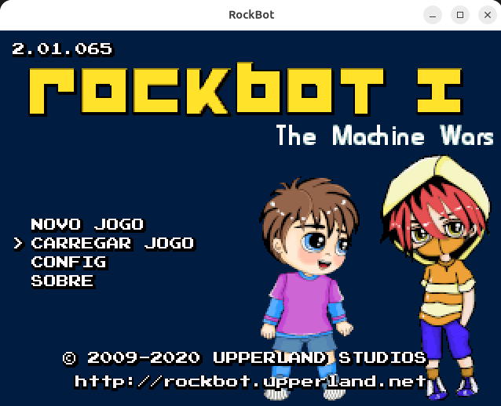
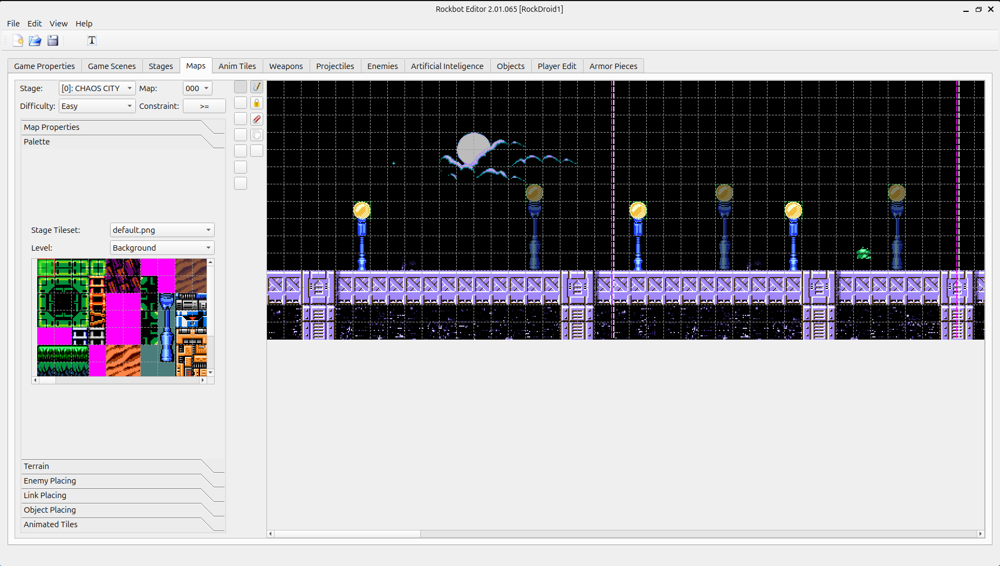

[](https://github.com/protoman/rockbot/actions/workflows/cd.yml)


# Rockbot Engine

**Rockbot** is an open-source 2D action-platformer engine in the spirit of the classic NES **Mega Man** games
(1-6 and 9-10). It is written in C++11 on top of SDL (1.2, 2 or 3), runs on PCs, phones and a long list of old
consoles and handhelds, and comes with a Qt-based **editor** to create your own stages, enemies, weapons,
cutscenes and graphics, so anyone can distribute their own game for the engine.

Two games are included:

| Game | Folder |
|---|---|
| **Rockbot 1** | `build/games/RockDroid1` |
| **Rockbot 2** | `build/games/RockDroid2` |

See the [manual](docs/manual.pdf) or the [manual\_famicom](docs/manual_famicom.pdf).



## Features

* Classic run, jump, slide and charged-shot gameplay, eight stages, boss weapons, E/W/S tanks, armor pieces.
* Playable robots with their own weapons and colors; difficulty levels.
* Scripted cutscenes, intro and ending, stage select in the "classic" or the modern style.
* Full data-driven content: everything (stages, maps, enemies, AI, objects, projectiles, scenes) is stored in data
  files made by the editor.
* Keyboard, joystick/gamepad and touch (Android) input; per-platform default button layouts.
* Three performance modes (low / normal / high) that the game lowers by itself on slow hardware.
* Languages: English, Portuguese, Spanish, French, Italian.

## Supported platforms

| Platform | Output | Notes |
|---|---|---|
| Linux x64 | `tar.gz`, `.deb`, AppImage | |
| Windows x64 / i686 | `.zip` | cross-built from Linux (llvm-mingw) |
| macOS | | `build-osx.sh` (not part of the release script) |
| Android | `.apk` | |
| Raspberry Pi (armhf / arm64) | `.tar.gz` | |
| Dingux / OpenDingux (Dingoo A320) | `.dge` | SDL 1.2, tested on a real Dingoo A320 |
| PocketGo | | SDL 1.2 |
| OpenPandora | `.pnd` | SDL 1.2; builds, not tested on hardware |
| PlayStation 2 | `.elf` | |
| PlayStation Portable | `EBOOT.PBP` | |
| PlayStation 3 | `.pkg` / folder | |
| PlayStation Vita | `.vpk` | tested on Vita3K |
| Nintendo Wii | Homebrew Channel app | tested on Dolphin |
| Nintendo GameCube | `.dol` | builds, not tested |
| Nintendo Switch | `.nro` | tested on Ryujinx |

Every build writes `rockbot_<platform>.<ext>` (for example `rockbot_linux`, `rockbot_playstation2.elf`,
`rockbot_dingux.dge`); see [docs/Releasing.md](docs/Releasing.md) for the exceptions where a loader needs a
fixed name.

## Requirements

* A C++11 compiler and CMake
* SDL 1.2, SDL2 or SDL3, with the `image`, `mixer`, `ttf` and `gfx` libraries
* Qt 5 (only for the editor)

## Build (Linux)

Install the dependencies and build the game and the editor (Ubuntu):

```bash
./build-ubuntu.sh sdl2          # or sdl1 / sdl3
```

Or build only the game, with the development packages already installed:

```bash
./build-linux.sh                # SDL2 (default); ./build-linux.sh sdl3 for SDL3
```

The binary is written to `build/rockbot_linux`.

## Run

* Game

```bash
(cd build && ./rockbot_linux)
```

* Editor

```bash
(cd build && GTK_PATH= ./editor)
```



### Default keyboard controls

| Action | Key |
|---|---|
| Move | Arrow keys |
| Jump | X |
| Shoot | A |
| Dash / slide | C |
| Shield | Z |
| Previous / next weapon | Q / W |
| Start / pause | Enter |
| Quit | Esc |

Keys and gamepad buttons can be changed in the options menu.

### Command line options

| Option | Effect |
|---|---|
| `--fullscreen` | start in full screen |
| `--gamename <name>` | select the game folder (for example `RockDroid2`) |
| `--quickload` | skip the intro and load the game directly (debug) |
| `--stage <n>` | start at stage `n` |
| `--player1` ... `--player4` | pick the player |
| `--invencible` | the player is not hurt by enemies |
| `--allweapons` | all weapons available |
| `--infinitejump` | jump again in the air |

## Building for other platforms

Each console or handheld has a `build-<platform>.sh` script in the repository root and a packaging script in
`build/packages` (`PS2.sh`, `Vita.sh`, `Dingux.sh`, ...). The SDKs are not part of the repository.

The whole build environment can also run in Docker, so it does not depend on the packages installed on your
machine and can be backed up and restored:

```bash
build/docker/build_images.sh                      # build the SDK images once
build/docker/run.sh psp ports/psp/build.sh        # build one platform inside its image
build/packages/release_all.sh --bump minor --game both --docker   # every platform, both games
```

* [docs/Docker.md](docs/Docker.md): using the images to build packages; [docs/DockerImages.md](docs/DockerImages.md): building the images, where each SDK comes from, backup and restore.
* [docs/Releasing.md](docs/Releasing.md): the release script, packages, adding a new port.
* [ports/](ports/): platform-specific code and notes (`psp`, `ps3`, `vita`, `switch`, `pandora`, `windows`, ...).

## Project layout

| Folder | Contents |
|---|---|
| `*.cpp`, `*.h` (root) | game flow, graphics, input, sound, stage and map code |
| `character/`, `objects/` | player, enemies (AI), items and stage objects |
| `scenes/`, `graphic/` | menus, cutscenes, HUD and drawing helpers |
| `file/` | data file formats and reading/writing |
| `editor/` | the Qt editor |
| `ports/` | platform code and build scripts for each target |
| `cmake/` | toolchain files |
| `build/games`, `build/shared`, `build/fonts` | game data shared by all builds |
| `build/packages` | packaging and release scripts |
| `build/docker` | Docker helper scripts |
| `docs/` | manuals, changelog, notes and build documentation |
| `scripts/` | helper tools (for example `audit_colorkey.py`) |
| `mega_drive/` | a separate Mega Drive port of the game |

## Tools

* `scripts/audit_colorkey.py`: finds images whose transparent color is not exactly the color key
  (RGB 75,125,125). See [docs/ColorKeyAudit.txt](docs/ColorKeyAudit.txt).

## License

* Source code: GPL v2 ([docs/LICENSE\_SOURCECODE.txt](docs/LICENSE_SOURCECODE.txt)).
* Art and sound files: Creative Commons Share-Alike (CC BY-SA 4.0). Music by Jmd is under the same license.
* Old music (`music/old`) belongs to its creators (modarchive.net); please check each license before
  redistributing it.
* Rockbot, Betabot, Kittybot, Candybod, Dr. Kanotus, Dr. Destrin and all bosses are copyright
  Iuri Fiedoruk and Arismeire Kümmer Silva Fiedoruk and respective collaborators, all rights reserved.

Details: [docs/LICENSE.TXT](docs/LICENSE.TXT). Credits for Rockbot 2: `Rockbot2_Credits.txt`.

