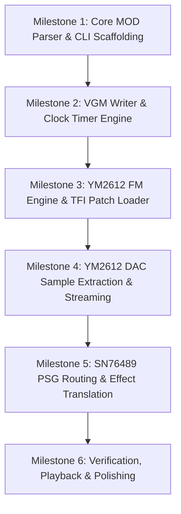

# Technical Plan: MOD to Mega Drive VGM Converter (`mod2vgm`)

## 1. Executive Summary

This document specifies the architecture, pipeline, and implementation plan for building a direct **Amiga MOD to Sega Mega Drive VGM converter**.

Because Amiga MOD uses PCM sample playback (Paula chip) and Sega Mega Drive primarily relies on FM synthesis (YM2612) and PSG (SN76489), a purely automated converter cannot synthesize FM operator parameters from raw audio waves without sounding like static noise or consuming extreme bandwidth via raw DAC streaming.

The solution is an **event-driven converter with a patch mapping definition (JSON/YAML)**:
1. Parse MOD pattern, note, tick, and effect data directly.
2. Map each MOD instrument ID to a target chip voice:
   - **YM2612 FM Channel** (using 4-OP instrument patches: TFI, GYB, or custom JSON).
   - **YM2612 DAC Channel** (for PCM percussion/drums).
   - **SN76489 PSG Channel** (for square wave leads/bass or noise percussions).
3. Translate pattern ticks, period values, volume, and effects into Mega Drive sound chip register writes.
4. Output compressed/uncompressed standard `.vgm` (or `.vgz`) files.

---

## 2. Target Specifications & Constraints

### 2.1 Amiga MOD Reference
* **Channels**: 4 fixed channels (`M.K.` / ProTracker standard).
* **Clock / Base Frequency**: PAL color clock standard:
  $$\text{Paula clock} = 3546895 \text{ Hz}$$
  $$\text{Sample Frequency} = \frac{3546895}{\text{Period} \times 2}$$
* **Timing**:
  * `Speed` (ticks per row, default: 6).
  * `BPM` (tick duration, default: 125 BPM $\rightarrow$ $50\text{ Hz} \rightarrow 20\text{ ms}$ per tick).
* **Pattern Structure**: 64 rows per pattern. Each cell contains:
  * Sample ID (0-31)
  * Period value (pitch / note)
  * Effect command + Parameter (e.g., `0xy` Arpeggio, `Cxy` Set Volume, `Exy` Sub-commands).

### 2.2 Sega Mega Drive Sound Subsystem
* **Primary FM Chip**: Yamaha YM2612 (OPN2) @ 7.670453 MHz (NTSC) / 7.600489 MHz (PAL).
  * 6 dual-operator/4-operator FM channels.
  * Channel 6 can operate as an 8-bit PCM DAC channel.
  * Frequency representation: `Block` (Octave 0-7) + `F-Number` (11-bit frequency counter).
* **Secondary PSG Chip**: Texas Instruments SN76489 @ 3.579545 MHz (NTSC).
  * 3 Square wave channels (10-bit pitch divider) + 1 White/Periodic Noise channel.
* **VGM Clock**: Standard sample rate reference is $44100\text{ Hz}$ samples per second.

---

## 3. High-Level Architecture

```
[ MOD File (.mod) ] 
       │
       ▼
┌──────────────────────────┐
│       MOD Parser         │  Extract patterns, order table, speeds, sample info
└──────────┬───────────────┘
           │
           ▼
┌──────────────────────────┐      ┌──────────────────────────────┐
│  Intermediate Event Log  │ ◄────│ Mapping Config (.json)       │
│  (Tick-accurate events)  │      │ - Instrument ID -> FM Patch  │
└──────────┬───────────────┘      │ - Instrument ID -> DAC Drum  │
           │                      │ - Instrument ID -> PSG Voice │
           ▼                      └──────────────────────────────┘
┌──────────────────────────┐
│ Mega Drive State Machine │
│ (Channel allocation &    │
│  Register computation)   │
└──────────┬───────────────┘
           │
           ▼
┌──────────────────────────┐
│       VGM Writer         │  Generates VGM Header, DAC data block, 
└──────────┬───────────────┘  YM2612 writes (0x52/0x53), PSG writes (0x50), wait ticks (0x61/0x62/0x63)
           │
           ▼
[ Output File (.vgm) ]
```

---

## 4. Key Components Design

### 4.1 Configuration File Format (`mapping.json`)
Allows assigning MOD samples to sound engines:

```json
{
  "target_chips": {
    "ym2612_clock": 7670453,
    "sn76489_clock": 3579545
  },
  "instruments": {
    "1": {
      "type": "fm",
      "name": "Bass",
      "voice_patch": {
        "algorithm": 4,
        "feedback": 5,
        "operators": [
          {"dt": 0, "mul": 1, "tl": 24, "ks": 0, "ar": 31, "dr": 12, "sr": 0, "rr": 7, "sl": 2, "ssg_eg": 0},
          {"dt": 0, "mul": 1, "tl": 18, "ks": 0, "ar": 31, "dr": 10, "sr": 0, "rr": 6, "sl": 1, "ssg_eg": 0},
          {"dt": 0, "mul": 2, "tl": 15, "ks": 0, "ar": 31, "dr": 8,  "sr": 0, "rr": 5, "sl": 1, "ssg_eg": 0},
          {"dt": 0, "mul": 1, "tl": 0,  "ks": 0, "ar": 31, "dr": 6,  "sr": 0, "rr": 4, "sl": 0, "ssg_eg": 0}
        ]
      }
    },
    "2": {
      "type": "dac",
      "name": "KickDrum",
      "sample_index": 2,
      "resample_rate": 11025
    },
    "3": {
      "type": "psg",
      "name": "SquareLead",
      "psg_type": "square",
      "envelope": [15, 12, 10, 8, 6, 4, 2, 0]
    }
  }
}
```

### 4.2 Frequency Translation

MOD Amiga Period to Note Frequency:
$$f = \frac{3546895}{\text{Period} \times 2}$$

YM2612 Frequency conversion:
$$\text{F-Number} = \frac{f \times 144 \times 2^{20}}{\Phi_{\text{M}} \times 2^{\text{Block}-1}}$$
Where $\Phi_{\text{M}} \approx 7670453\text{ Hz}$.

SN76489 Pitch conversion:
$$N = \frac{\Phi_{\text{PSG}}}{32 \times f}$$

### 4.3 Channel Allocation Strategy
Amiga has 4 channels. Mega Drive has:
* 6 FM channels (or 5 FM + 1 DAC)
* 3 PSG square channels + 1 PSG noise channel

**Default Channel Mapping Matrix:**
* MOD Ch 0 $\rightarrow$ YM2612 Ch 1 (FM)
* MOD Ch 1 $\rightarrow$ YM2612 Ch 2 (FM)
* MOD Ch 2 $\rightarrow$ YM2612 Ch 3 (FM)
* MOD Ch 3 (percussion/lead) $\rightarrow$ YM2612 Ch 6 (DAC for drums) OR SN76489 / YM2612 Ch 4.

### 4.4 Supported Effects Translation
* `0xy` (Arpeggio): Rapid pitch alternation across ticks $\rightarrow$ adjust FM F-Number or PSG divider per tick.
* `1xx` / `2xx` (Portamento Up/Down): Update frequency registers each tick.
* `3xx` (Tone Portamento): Slide current note towards target note.
* `Cxx` (Set Volume): Scale MOD volume (0-64) into YM2612 TL (Total Level, 0-127 inverted logarithmic) or PSG attenuation (0-15).
* `Fxx` (Set Speed/BPM): Dynamically adjust wait tick durations in VGM.

---

## 5. Development Milestones



### Milestone 1: Core MOD Parser & CLI Scaffolding
- Parse standard 31-instrument ProTracker modules (`M.K.` magic tag).
- Extract pattern rows, note periods, instrument indexes, effect codes.
- Create an intermediate tick-by-tick event stream.
- **Verification**: CLI prints order list, pattern count, instrument names, and per-row decoded notes.

### Milestone 2: VGM Writer & Clock Timer Engine
- Implement standard VGM v1.50+ writer.
- Header generation (YM2612 clock, PSG clock, sample count, loop points).
- Implement commands:
  - `0x52 aa dd` (YM2612 Port 0 write)
  - `0x53 aa dd` (YM2612 Port 1 write)
  - `0x50 dd` (PSG write)
  - `0x61 nn nn` (Wait $n$ samples @ 44100 Hz)
  - `0x62` (Wait 735 samples / $60\text{ Hz}$ frame)
  - `0x63` (Wait 882 samples / $50\text{ Hz}$ frame)
  - `0x66` (End of sound data)
- **Verification**: Output a minimal valid VGM that plays a simple tone on YM2612 and verify in VGM player (e.g., Audacious, foobar2000 with vgmstream, or Deflemask/Furnace).

### Milestone 3: YM2612 FM Engine & TFI Patch Loader
- Load standard 4-OP instrument patches (`.tfi` files or JSON definitions).
- Convert note periods to YM2612 Block + F-Number.
- Handle Key On (`0x28`) and Key Off commands.
- Implement volume mapping (MOD volume $\rightarrow$ Operator Total Level registers).
- **Verification**: Convert melodic MOD tracks using default/mapped FM instruments and listen to output.

### Milestone 4: DAC Support for Percussion
- Extract 8-bit unsigned PCM samples from MOD for designated drum instruments.
- Resample samples to standard Genesis DAC rates (e.g., 8 kHz - 16 kHz).
- Emit VGM data block (`0x67 0x66 0x00 ...`) and setup DAC streaming commands (`0x90` - `0x95` DAC stream control or direct `0x52 0x2a` register writes).
- **Verification**: Drums trigger properly on channel 6 without locking up FM playback.

### Milestone 5: PSG Routing & ProTracker Effects
- Implement SN76489 pitch register calculation.
- Map ProTracker effects:
  - Portamento (`1xx`, `2xx`, `3xx`)
  - Volume slides (`Axx`)
  - Tremolo/Vibrato (`4xx`, `7xx`)
  - Pattern break / Position jump (`Bxx`, `Dxx`)
- **Verification**: Listen to complex chiptune MODs with vibrato and slides; ensure smooth pitch transitions.

### Milestone 6: Quality Verification & Tooling
- Add automated template generator: `mod2vgm generate-template song.mod -> song_config.json`.
  - Automatically identifies instrument sample names (e.g., strings containing "bass", "lead", "kick", "snare") and assigns reasonable default FM patches or DAC drums.
- Test conversion against target songs in `RockDroid1/music`.
- Validate playback in Mega Drive emulators (BlastEm, Genesis Plus GX, Ares) and on real flashcart hardware (Mega EverDrive).

---

## 6. Implementation Language & Dependencies Recommendation

* **Language**: C++11 (matching the rockbot codebase) or Rust / Python for standalone CLI utility.
  * *Recommendation for C++11*: Reuses rockbot conventions, easy compilation with CMake, zero external dependencies required for basic VGM generation.
* **Libraries**:
  * Optional: `zlib` for writing compressed `.vgz` output directly.
  * Standard STL for data structures.

---

## 7. Alternative Pragmatic Path (Tracker Bridge)

If full manual converter development is deemed too resource-intensive:
1. **MOD $\rightarrow$ Furnace Tracker (.fur)**:
   * Furnace Tracker has an open format and CLI scripting capability. It imports MOD files natively and supports exporting to VGM directly.
   * You can write a small script that loads the MOD in Furnace, loads a Genesis soundbank (TFI/OPN2), links instruments, and exports VGM via Furnace CLI in headless mode.
